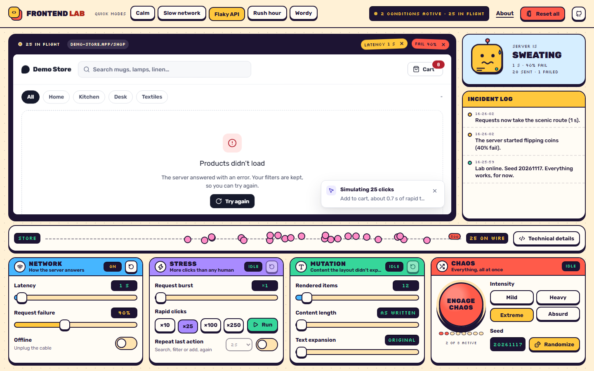
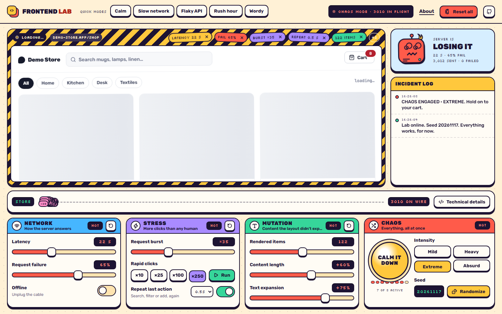
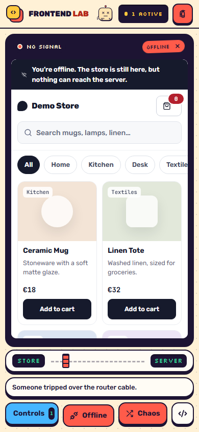

# Frontend Lab

> **Make the web misbehave.**

A toy lab with one tiny web store inside. Slow the network down, fail requests, pull the cable,
flood the store with clicks, stretch its copy until cards give up, then hit the big red button.
Every effect is real behaviour driven by a reusable, deterministic simulation engine, and one
click on the extinguisher puts everything back.

**Live demo:** https://destegio.github.io/Frontend-Lab/



| Chaos mode                                                                                            | Phone layout                                                       |
| ----------------------------------------------------------------------------------------------------- | ------------------------------------------------------------------ |
|  |  |

## What you can do

| Module       | Controls                                                               | What happens                                                                                                                  |
| ------------ | ---------------------------------------------------------------------- | ----------------------------------------------------------------------------------------------------------------------------- |
| **Network**  | latency 0 to 60 s, failure 0 to 100%, offline                          | Requests crawl along the wire, fail with 500/503, or hit a wall. Past 30 s the store's client times out.                      |
| **Stress**   | request burst ×1 to ×100, rapid clicks ×10 to ×250, repeat last action | Every action fires N parallel calls; rapid clicks hammer Add to cart; the last search, filter or add re-fires on an interval. |
| **Mutation** | items 1 to 240, content length, text expansion                         | The catalog multiplies, descriptions grow, words get accented and up to 3.2× longer.                                          |
| **Chaos**    | intensity mild / heavy / extreme / absurd, seed, randomize             | A 3-2-1 countdown, then every condition at once, generated from the seed.                                                     |

Quick modes (Calm, Slow network, Flaky API, Rush hour, Wordy) replace all conditions in one press.
Every condition shows up as a removable sticker on the screen bezel.

The lab makes the simulation visible:

- **The wire.** Every packet is a real in-flight request from the engine and travels for exactly
  its simulated duration. Results pop at the server end; offline packets hit a wall.
- **The server.** A small character whose face summarises the conditions: happy, snoozing,
  sweating, overwhelmed, unplugged, losing it.
- **The incident log.** Notable changes and outcomes narrated in plain words
  ("The server sneezed. 12 requests lost."). Which joke you get is decided by the seed.
- **The store breaks physically.** It wobbles in proportion to the load, failed cards get taped
  up, and chaos tilts every card inside a hazard-tape frame.
- **Technical details.** Counters, the number of cards actually in the DOM, and a request log.

No lessons, no scores, no challenges.

## Tech stack

React 19 · TypeScript (strict) · Vite · Tailwind CSS 4 · React Router · TanStack Virtual ·
Lucide · Vitest · Testing Library · Playwright with axe-core

No state library: the engine is an external store read through `useSyncExternalStore`, and the
store and lab use `useReducer` and plain hooks.

## Architecture

```
src/
  simulation/          framework-agnostic engine (no React)
    engine.ts          request layer, timers, cancellation, reset, stats, log, flights
    config.ts          typed config, limits, sanitising, merging
    rng.ts             seeded PRNG (mulberry32) and seed hashing
    scenarios.ts       presets, seeded chaos profiles, randomize
    conditions.ts      active conditions, thresholds, per-group defaults
    mutation.ts        pure text transforms (expansion, filler)
    adapters/          React provider and hooks (useSyncExternalStore)
  features/
    demo-store/        the specimen: catalog, API client, reducer, virtualized grid
    playground/        the lab: screen, wire, server, deck modules, chaos show, incident log
    pages/             landing, about, 404
  components/          toy primitives (buttons, faders, switches, LEDs) and layout
```

Two deliberate boundaries:

1. **The engine knows nothing about React or the store.** It could ship as its own package.
   The store knows nothing about the lab: it calls its API client, and the engine decides how
   slow, flaky or offline the "server" is.
2. **The store looks like an ordinary web shop.** The arcade style belongs to the lab around it,
   so the specimen reads as a real site being broken, not as part of the toy.

## The simulation engine

Every store request goes through `engine.request()`:

```ts
const res = await engine.request({
  method: 'GET',
  path: '/api/products?category=kitchen&limit=12',
  respond: () => query, // body, built only if the request succeeds
  signal: controller.signal, // AbortSignal
  timeoutMs: 30_000, // client-side timeout
});
// res: { status, ok, outcome: 'ok' | 'error' | 'offline' | 'timeout' | 'throttled', data, durationMs, burst }
```

- **Config is captured when a request starts.** Moving a slider never rewrites a request
  already on the wire.
- **Deterministic.** Each request draws from its own RNG, seeded by `hash(seed, request index)`,
  in a fixed order (jitter, outcome, burst duplicates). The same seed and the same actions replay
  the same statuses and durations regardless of timing. Chaos configurations, randomize and the
  incident log's wording are seeded too.
- **Bursts are logical.** Duplicates share the primary call's timer and are only counted, so
  ×100 costs no more than ×1.
- **Cancellation.** Aborting a signal frees the request immediately and logs it. The store uses
  this for latest-wins searching: a new search or filter cancels the previous fetch.
- **Reset.** `reset()` rejects every pending request with an `AbortError`, clears every
  engine-owned timer (debounces, toasts, repeats, click runs, the chaos countdown), empties stats
  and log, restores defaults and bumps a generation counter. Callbacks check the generation, so a
  late response can never touch fresh state. Seed and chaos level survive, so a run can be
  replayed.
- **No `setInterval`.** Repeats are chains of one-shot timers owned by the engine.
- **Notifications are batched** to one per microtask, which keeps React renders cheap under load.

## Performance and safety

The lab represents extreme workloads without performing them literally:

| Limit                            | Value                   | Beyond it                                                                    |
| -------------------------------- | ----------------------- | ---------------------------------------------------------------------------- |
| Real pending requests            | 400                     | the client answers 429 instead of creating more timers                       |
| Executed stress actions per run  | 250 (one every 28 ms)   | the rest is counted as simulated (Absurd chaos: 10,000 clicks, 250 executed) |
| Log entries / toasts / incidents | 80 / 40 / 30            | oldest dropped                                                               |
| Packets drawn on the wire        | 24                      | summarised by the LED counter                                                |
| Product cards in the DOM         | visible rows + overscan | the grid is virtualized with measured rows                                   |

Generated content is plain strings rendered as text, so mutations cannot inject markup. The store
scrolls and overflows inside its own frame; the page around it never moves (checked in e2e at
desktop and phone sizes). Every animation, including the countdown, shake and wobble, collapses
under `prefers-reduced-motion`, and chaos then engages without the countdown.

## Accessibility

Target WCAG 2.2 AA. All controls are native elements (range inputs, checkbox switches, buttons,
select), labelled and keyboard operable; faders announce their value with `aria-valuetext`.
State is never colour-only: LEDs and stickers carry text, the server mood has an accessible name.
Live regions: lab status, store toasts, the incident log (`role="log"`); store errors use
`role="alert"`. The phone controls sheet is a native modal `<dialog>`. axe-core runs on every
page in the e2e suite.

## Getting started

```bash
npm install
npm run dev          # http://localhost:5173
```

| Script                               |                                                                                             |
| ------------------------------------ | ------------------------------------------------------------------------------------------- |
| `npm run dev`                        | dev server                                                                                  |
| `npm run build`                      | typecheck and production build                                                              |
| `npm run preview`                    | serve the build                                                                             |
| `npm run lint` / `npm run typecheck` | ESLint / TypeScript                                                                         |
| `npm test`                           | unit and component tests (Vitest)                                                           |
| `npm run test:e2e`                   | end-to-end and accessibility tests (Playwright; run `npx playwright install chromium` once) |

## Testing

- **Engine** (fake timers): latency bounds, captured config, offline, failure boundaries
  (0%, 100%, ~50%), seed reproducibility, replay after reset, cancellation, timeouts, reset of
  requests and timers, bursts, combined conditions, request ordering, the 429 ceiling, bounded
  action runs, notification batching, in-flight exposure.
- **Scenarios**: deterministic chaos per seed and level, profile bounds, escalation, presets,
  condition listing and clearing, thresholds, text transforms.
- **Demo Store** (Testing Library): loading, search with debounce, empty state, filters,
  add to cart, failed adds, error and retry, offline, timeout, latest-wins cancellation, reset
  with late responses, mutations, virtualization.
- **Playground**: presets and stickers, keyboard, chaos countdown and reproducibility, reset
  during countdown, rapid clicks, repeat, reset, technical details; server mood and incident
  narration.
- **E2E** (Playwright, desktop and phone): navigation, store, quick modes, offline, chaos and
  reset, keyboard, the phone sheet, content containment, and an axe scan of every page.

CI runs lint, typecheck, unit tests, build and the e2e suite on every push and pull request;
pushes to `main` deploy to GitHub Pages.

## Known limitations

- The network is simulated inside the page. Real `fetch` calls, service workers and browser
  throttling are deliberately not touched.
- Rapid clicks above 250 per run are counted, not executed, by design.
- The wire draws at most 24 packets; under heavy load it is a sample, the counter is exact.
- Seeded reproducibility covers request outcomes and generated configurations. Wall-clock
  details (timestamps, which frame a packet is drawn in) naturally differ between runs.
- GitHub Pages has no SPA fallback, so the deploy copies `index.html` to `404.html`.
